# Lab Ecosystem

A unified monorepo hosting personal self-hosted infrastructure (**`home_lab/`**) and an extensive, production-grade cybersecurity simulation and training ecosystem (**`cyber_lab/`**).

---

## Repository Structure

```text
lab/
├── home_lab/               # Self-hosted infrastructure, media services, and tooling
│   ├── immich-app/         # Self-hosted photo and video backup solution
│   ├── media-stack/        # Automated media management (Jellyfin, *arr suite, qBittorrent)
│   ├── Stirling-PDF/       # Self-hosted web-based PDF Swiss-army knife
│   └── vpn-proxy/          # Network privacy and outbound routing stacks
├── cyber_lab/              # 800+ target enterprise cybersecurity training platform
│   ├── Classes/            # Syllabus tracks (Ethical Hacking, Web, Network, Exploitation)
│   ├── Real_World_Industry_Labs/ # Industry domains (Cloud/K8s, DevSecOps, OAuth2, Web3, IoT)
│   ├── tools/              # Dedicated offensive, defensive SOC, and DFIR tool suites
│   ├── lab                 # Unified CLI management utility for all cyber labs
│   └── SESSION_QUICKSTART.md # Architecture baseline, memory rules, and hardware inventory
├── install-docker.sh       # Automated Docker Engine + Lazydocker bootstrap script
└── docker-reset.sh         # Complete Docker environment wipe and teardown utility
```

---

## 1. Home Lab (`home_lab/`)

Self-hosted microservices for local storage, media automation, network security, and utility tooling.

| Stack | Core Services | Container Count | Exposed Ports | Primary Function |
| :--- | :--- | :---: | :--- | :--- |
| **Immich** | `immich-server`, `immich-machine-learning`, `valkey`, `postgres` | 4 | `2283` | High-performance mobile/web photo & video backup |
| **Media Stack** | `jellyfin`, `qbittorrent`, `prowlarr`, `sonarr`, `radarr` | 5 | `8096`, `8080`, `9696`, `8989`, `7878` | End-to-end media automation, torrenting, and streaming |
| **Pi-hole** | `pihole` | 1 | `53/udp`, `53/tcp`, `80`, `443` | Network-wide DNS ad-blocking and local domain resolution |
| **Stirling PDF** | `stirling-pdf` | 1 | `9000` | Full-featured OCR, redaction, splitting, and PDF conversion |
| **Hadoop** | `hadoop-namenode` | 1 | `9870`, `8088` | Distributed HDFS storage & YARN cluster management |

---

## 2. Cyber Lab (`cyber_lab/`)

The **`cyber_lab`** environment is an enterprise-grade offensive and defensive cybersecurity platform featuring **800+ vulnerable targets, real-world attack scenarios, and specialized tooling suites**.

Everything is orchestrated through the central CLI tool [`cyber_lab/lab`](cyber_lab/lab), enabling on-demand deployment without overloading host memory.

> [!IMPORTANT]
> **Operational Sizing Rule**: Never launch all 800+ labs at once. Start targets **on-demand** using `./lab start <shortcut>` and shut them down when finished using `./lab stop <shortcut>` or `./lab stop-all`.

```bash
cd cyber_lab
./lab list                  # Search all 800+ available targets and shortcuts
./lab start <shortcut>      # Start target container stack on demand
./lab shell <shortcut>      # Drop into an interactive shell inside target container
./lab status                # Show currently running lab containers and exposed ports
./lab stop <shortcut>       # Stop a specific lab container
./lab stop-all              # Gracefully shut down all running cyber lab containers
```

---

### Cyber Lab Architecture & Core Divisions

The security ecosystem is structured into three clean functional divisions:

```mermaid
graph TD
    CL["cyber_lab/"] --> C["Classes/ (Curriculum Tracks)"]
    CL --> R["Real_World_Industry_Labs/ (Modern Domains)"]
    CL --> T["tools/ (Security Tooling Suite)"]

    C --> C1["01: Ethical Hacking & Recon"]
    C --> C2["02: Web Pentesting (PortSwigger/OWASP)"]
    C --> C3["03: Network Security"]
    C --> C4["04: Network Pentesting & Middleware CVEs"]
    C --> C5["05: Exploit Writing (BoF, ROP, Shellcoding)"]

    R --> R1["AI & LLM Security"]
    R --> R2["Cloud Native & K8s Escapes"]
    R --> R3["DevSecOps & CI/CD Poisoning"]
    R --> R4["Identity, OAuth2 & Vault"]
    R --> R5["Multi-Cloud (AWS, Azure, GCP)"]
    R --> R6["Web3 & Smart Contracts"]
    R --> R7["OT/SCADA & IoT Firmware"]

    T --> T1["Network NSM (Zeek, Suricata, Snort)"]
    T --> T2["Offensive & C2 (Sliver, Caldera, Gophish)"]
    T --> T3["Defensive SOC (Cowrie, Velociraptor, MISP)"]
    T --> T4["Analysis & DFIR (REMnux, CyberChef, Scanners)"]
```



---

### Division 1: Academic & Certification Curriculum Tracks (`Classes/`)

Comprehensive labs aligned with CREST, OSCP, OSWE, and eWPTX syllabi:

#### 1. Ethical Hacking & System Fundamentals (`Classes/01_cyber_security_ethical_hacking/`)
- **Network Recon & Scanning** ([`scanning_and_recon`](cyber_lab/Classes/01_cyber_security_ethical_hacking/scanning_and_recon)): Nmap timing templates, service fingerprinting, NSE scripting. Shortcut: `./lab start recon` (`:8081`).
- **Metasploit Target System** ([`metasploit_and_system_hacking`](cyber_lab/Classes/01_cyber_security_ethical_hacking/metasploit_and_system_hacking)): Multi-service exploitation (`:2121`, `:2222`, `:2323`, `:8082`). Shortcut: `./lab start meta-target`.
- **DVWA Fundamentals** ([`web_basics_dvwa`](cyber_lab/Classes/01_cyber_security_ethical_hacking/web_basics_dvwa)): Core web vulnerabilities across Low/Medium/High security modes. Shortcut: `./lab start dvwa-basic` (`:8083`).
- **CTFd Challenge Platform** ([`ctf_intro_challenges`](cyber_lab/Classes/01_cyber_security_ethical_hacking/ctf_intro_challenges)): Self-hosted Jeopardy CTF engine. Shortcut: `./lab start ctfd` (`:8000`).

#### 2. Advanced Web Penetration Testing (`Classes/02_web_penetration_tester/`)
*Includes full PortSwigger Web Security Academy mapping: Apprentice $\to$ Practitioner $\to$ Expert ([Roadmap](cyber_lab/Classes/02_web_penetration_tester/PORTSWIGGER_ROADMAP.md)).*

- **API Penetration Testing**:
  - REST API security flaws & BOLA/IDOR: [`vampi`](cyber_lab/Classes/02_web_penetration_tester/03_api_penetration_testing/rest_vampi) (`:5000`).
  - Damn Vulnerable GraphQL Application: [`dvga`](cyber_lab/Classes/02_web_penetration_tester/03_api_penetration_testing/graphql_dvga) (`:5013`).
  - Microservices authentication & business logic: [`crapi`](cyber_lab/Classes/02_web_penetration_tester/03_api_penetration_testing/crapi_microservices) (`:8888`, `:8025`).
- **Enterprise Web Frameworks & OWASP Top 10**:
  - OWASP Juice Shop (`:3000`), OWASP WebGoat/WebWolf (`:8099`, `:9090`), RailsGoat (`:8109`), Mutillidae II (`:8116`), bWAPP (`:8085`).
- **Modern Web Exploitation**:
  - **HTTP Request Smuggling**: Front-end / back-end desynchronization (CL.TE, TE.CL, TE.TE) (`:8108`).
  - **SSTI (Server-Side Template Injection)**: Jinja2, Twig, Velocity, and Spring SpEL sandbox escapes (`:8094`, `:8130`).
  - **Prototype Pollution**: Client-side & server-side NodeJS prototype pollution to RCE (`:8096`, `:8155`).
  - **Race Conditions**: Limit overrun, multi-threaded checkout race, and database concurrency flaws (`:8097`).
  - **Insecure Deserialization**: Java (ysoserial, Shiro, Fastjson, XStream), Python pickle, and PHP object injection (`:8095`, `:8127`, `:8128`, `:8202`).
  - **Server-Side Attacks**: Log4j JNDI injection (`:8104`), Blind XXE, SSRF to Cloud metadata.
  - **CMS Security**: High-severity CVE labs for WordPress, Drupal (Drupalgeddon 1/2/3), Joomla, CraftCMS, ThinkPHP, and Discuz.

#### 3. Network Security (`Classes/03_network_security/`)
- **DNS Tunneling & Exfiltration** ([`dns_tunneling`](cyber_lab/Classes/03_network_security/dns_tunneling)): Covert data channel simulation and payload exfiltration detection over UDP `5353`. Shortcut: `./lab start dns-tunnel`.

#### 4. Network Penetration Testing & Enterprise Middleware (`Classes/04_network_penetration_tester/`)
- **Active Directory & Identity**:
  - **GOAD LDAP Environment**: Multi-tier LDAP directory querying & Kerberoasting (`:3893`). Shortcut: `./lab start ad-ldap`.
  - **Samba Active Directory & Kerberos**: Full Domain Controller emulation (Kerberos `88`, LDAP `389`, SMB `445`). Shortcut: `./lab start ad-kerberos`.
- **Infrastructure Services**:
  - Metasploitable2 legacy services, Linux Privilege Escalation lab (`privesc-linux`), SambaCry (`:4455`), Rsync unauthorized RCE (`:8154`), OpenSSH enumeration (`:8160`), OpenSMTPD RCE (`:8192`), MySQL Auth Bypass (`:8179`).
- **Enterprise Middleware CVE Matrix (200+ dedicated labs)**:
  - **Apache Struts2**: Complete S2-001 through S2-067 OGNL execution series (S2-016, S2-045, S2-048, S2-057, S2-061, S2-066).
  - **Oracle WebLogic**: T3 protocol deserialization, XMLDecoder RCE, and WLS-WSAT flaws (CVE-2017-10271, CVE-2018-2628, CVE-2020-14882, CVE-2023-21839).
  - **Apache Tomcat**: Ghostcat AJP traversal (CVE-2020-1938), PUT method arbitrary JSP upload (CVE-2017-12615).
  - **Spring Framework**: Spring4Shell (CVE-2022-22965), Spring Cloud Gateway RCE (CVE-2022-22947), Spring Cloud Function (CVE-2022-22963).
  - **Message Brokers & Queues**: Apache ActiveMQ (CVE-2015-5254, CVE-2016-3088, CVE-2023-46604 OpenWire RCE), Apache RocketMQ, Redis unauthenticated Lua sandbox escape.

#### 5. Binary Exploitation & Exploit Writing (`Classes/05_exploit_writing/`)
- **Stack Buffer Overflows** ([`05_stack_buffer_overflow_env`](cyber_lab/Classes/05_exploit_writing/05_stack_buffer_overflow_env)): Controlled EIP/RIP hijacking, offset determination, and stack alignment. Shortcut: `./lab start bof`.
- **Shellcoding & Encoders** ([`06_13_14_shellcoding_and_encoders`](cyber_lab/Classes/05_exploit_writing/06_13_14_shellcoding_and_encoders)): Writing pure assembly shellcode, avoiding bad characters (`\x00`, `\x0a`), alphanumeric encoding. Shortcut: `./lab start shellcoder`.
- **DEP & ASLR Bypass** ([`12_dep_aslr_bypass`](cyber_lab/Classes/05_exploit_writing/12_dep_aslr_bypass)): Modern mitigation evasion: Return-to-libc, ROP gadget chain building, and GOT overwrite.

---

### Division 2: Real-World Industry Laboratories (`Real_World_Industry_Labs/`)

Hardened, production-grade attack scenarios mirroring real adversary engagements:

| Domain | Key Labs & Scenarios | CVEs / Standards | Shortcut | Exposed Ports |
| :--- | :--- | :--- | :--- | :--- |
| **AI & LLM Security** | OWASP PyGoat LLM (Prompt injection, indirect prompt injection, insecure output handling, model pickle deserialization) | OWASP Top 10 LLM | `ai-pygoat` | `8091` |
| | Jupyter Notebook unauthenticated API token bypass to shell | CVE-2019-10255 | `jupyter-token-bypass` | `8148` |
| **Cloud & K8s Escapes** | BadRobot container escape (`CAP_SYS_ADMIN`, cgroups, rootfs mount) | Linux Namespaces | `container-escape` | Host |
| | Kubernetes Goat (22 real-world cluster scenarios: Helm, RBAC, Falco) | Cloud Native K8s | `k8s-goat` | `8105` |
| | OPA Gatekeeper policy evasion and admission webhook bypass | Rego Logic Bypass | `opa-bypass` | `8111` |
| | Docker daemon remote TCP API unauthenticated host filesystem escape | Misconfig | `docker-api` | `2375` |
| | Apache Spark Standalone cluster manager REST RCE | CVE-2022-33891 | `spark-unauth-rce` | `8144`, `8145` |
| | Apache Hadoop YARN ResourceManager REST API command execution | Unauth REST | `hadoop-yarn-rce` | `8162` |
| | Apache Druid JavaScript ingestion expression evaluation RCE | CVE-2021-25646 | `druid-rce` | `8183` |
| | GeoServer unauthenticated JXPath evaluation RCE | CVE-2024-36401 | `geoserver-rce` | `8193` |
| **DevSecOps & Supply Chain** | Poisoned Pipeline Execution (PPE) in Gitea runners | Supply Chain CI/CD | `cicd-gitea` | `3002` |
| | Cider Security CI/CD Goat (OWASP Top 10 CI/CD Security Risks) | OWASP CI/CD | `cicd-goat` | `8112` |
| | OWASP WrongSecrets (Secrets in Docker layers, git, K8s, Vault) | Secret Sprawl | `wrongsecrets` | `8100` |
| | Verdaccio NPM private registry poisoning & Dependency Confusion | Dependency Hijack | `verdaccio` | `8110` |
| | Sonatype Nexus 3 Java Expression Language (JUEL) RCE | CVE-2020-10199 | `nexus-rce` | `8136` |
| | SaltStack salt-api unauthenticated shell injection | CVE-2020-16846 | `saltstack-rce` | `8190` |
| | Apache Airflow Celery task command injection & cookie forgery | CVE-2020-11978 | `airflow-dag-rce` | `8227`, `8228` |
| **Identity & Secrets** | Keycloak OAuth2 / OIDC IDOR, token replay, redirect URI spoofing | RFC 6749 / OIDC | `oauth-keycloak` | `8093` |
| | HashiCorp Vault security (ACL policy escalation, AppRole abuse) | Vault Architecture | `vault` | `8200` |
| | OWASP SecureBank (FinTech race conditions, double-spending, BOLA) | Financial APIs | `securebank` | `8118`, `5001` |
| | Spring Security OAuth2 whitelabel SpEL expression injection RCE | CVE-2016-4977 | `spring-oauth2-rce` | `8170` |
| | Apache APISIX Dashboard unauthenticated dropper RCE | CVE-2021-45232 | `apisix-dashboard-rce`| `8225`, `8226` |
| **Multi-Cloud Security** | AWS LocalStack (Offline S3, IAM escalation, Lambda exploitation) | AWS IAM | `aws-localstack` | `4566` |
| | Rhino Security CloudGoat (21 vulnerable AWS paths, EC2 IMDS SSRF) | CloudGoat Suite | `cloudgoat` | CLI |
| | INE AzureGoat (Entra ID RBAC escalation, Managed Identity theft) | Azure Cloud | `azuregoat` | CLI |
| | INE GCPGoat (GCP IAM privilege escalation, bucket traversal, IMDS) | GCP Security | `gcpgoat` | CLI |
| | MinIO S3 cluster verify environment information disclosure | CVE-2023-28432 | `minio-leak` | `9000`, `9002` |
| **Web3 & Blockchain** | EVM Vulnerable Bank (Solidity reentrancy, oracle price manipulation) | Smart Contract Top 10 | `web3-evm` | `8545` |
| **IoT, SCADA & OT** | Firmadyne Linux MIPS/ARM IoT firmware extraction and emulation | Firmware Hardware | `iot-firmware` | CLI |
| | OpenPLC v3 SCADA & Modbus TCP (Holding register tampering, coil forcing) | Industrial Control | `openplc-modbus` | `502`, `8123` |
| | Insecure anonymous MQTT broker & telemetry eavesdropping (`#` wildcard) | ICS / Smart Home | `iot-mqtt` | `1883`, `9001` |
| | GoAhead embedded web server `LD_PRELOAD` dynamic linker hijacking | CVE-2017-17562 | `goahead-rce` | `8149` |

---

### Division 3: Dedicated Defensive, Offensive & DFIR Tool Suite (`tools/`)

The repository includes a complete production security operations center, adversary emulation platform, and forensic analysis workstation suite:

```text
tools/
├── network/          # Zeek NSM, Suricata + EveBox, Snort IDS/IPS
├── offensive/        # Sliver C2, MITRE Caldera, Gophish, Interactsh OOB, JWT-Tool
├── defensive_soc/    # Cowrie Honeypot, Velociraptor, MISP Threat Intel, DefectDojo
└── analysis/         # REMnux Malware Toolkit, DFIR CyberChef + Volatility 3, DevSecOps
```

| Domain | Tool & Platform | Description & Capabilities | Shortcut | Ports |
| :--- | :--- | :--- | :--- | :--- |
| **Network Monitoring** | **Zeek NSM + Web Wireshark** | Protocol analysis, connection logging (`conn.log`, `dns.log`, `ssl.log`), JA3/JA4 fingerprinting, in-browser packet analysis | `./lab start zeek` | `3003` |
| | **Suricata + EveBox** | Multi-threaded NIDS/NIPS engine, signature matching, EVE JSON telemetry, and EveBox triage UI | `./lab start suricata` | `8113` |
| | **Snort IDS/IPS** | Industry-standard rule-based network intrusion detection system | `./lab start snort` | Host Mode |
| **Offensive & Red Team** | **Sliver C2** | BishopFox Go/C cross-platform Command & Control (mTLS, WireGuard, DNS beacons) | `./lab start c2-sliver` | `8889`, `31337` |
| | **MITRE Caldera** | Automated adversary emulation platform mapped directly to MITRE ATT&CK techniques | `./lab start c2-caldera` | `8888` |
| | **Gophish** | Open-source enterprise phishing campaign and awareness training simulator | `./lab start phish-gophish` | `3333` (Admin), `8092` |
| | **Interactsh OOB** | Self-hosted Out-of-Band callback server for blind SSRF, XXE, and RCE verification | `./lab start oob` | `8090`, `5354` |
| | **JWT Tool Workspace** | CLI utility for tampering, dictionary attacks, and key confusion testing on JWTs | `./lab start jwt` | Shell |
| **Defensive SOC & CTI** | **Cowrie Honeypot** | Medium/high-interaction SSH and Telnet honeypot with keystroke replay logging | `./lab start cowrie` | `2223`, `2324` |
| | **Velociraptor** | Live endpoint forensics, artifact collection, and VQL threat hunting console | `./lab start velociraptor` | `8114` |
| | **MISP Threat Intel** | Cyber Threat Intelligence sharing platform for IoC correlation and STIX/TAXII feeds | `./lab start misp` | `8115` |
| | **DefectDojo** | DevSecOps vulnerability management, deduplication, and CVSS triaging dashboard | `./lab start threat-intel` | `8098` |
| **Forensics & Analysis** | **REMnux Workstation** | SANS FOR610 reverse engineering environment (Capa, FLOSS, PEfile, Olevba, Ghidra) | `./lab start remnux` | Shell |
| | **DFIR Suite** | CyberChef deobfuscation platform + Volatility 3 memory analysis + YARA rules | `./lab start dfir` | `8106` |
| | **DevSecOps Pipeline** | Automated SAST, SCA, and secret scanning pipeline (Semgrep + Trivy + Gitleaks) | `./lab start scanner-pipeline` | `8102` |

---

## 3. Operational Rules & Safety Framework

Running hundreds of intentionally vulnerable applications and exploitation tools requires strict operational discipline to prevent host instability, data compromise, or accidental traffic leakage.

### Rule 1: Network Isolation & Egress Containment
- **No WAN Exposure**: Target containers must **never** be exposed directly to a public IP address or bridged onto untrusted public networks.
- **Egress Filtering**: Block outbound connections originating from vulnerable lab containers (`DOCKER-USER` chain) to the Internet. In dynamic web attacks (e.g., SSRF, Log4j JNDI, reverse shells), use the internal [`interactsh-oob`](cyber_lab/tools/offensive/interactsh-oob) listener (`Port 8090`) or dedicated internal C2 servers rather than public endpoints.
- **Separate Management & Lab Traffic**: Maintain an isolated host-only / private virtual network between the attacker machine (Kali Linux) and the target server.

### Rule 2: Concurrency & Host Resource Budgeting
- **Strict On-Demand Execution**: On an 8-core / 14–16 GB RAM baseline machine, **never** execute multiple heavy enterprise stacks simultaneously.
- **Maximum Concurrent Stacks**:
  - Up to 3–5 lightweight targets (DVWA, SQLi-labs, VAmPI, bWAPP).
  - Maximum **1** heavy enterprise target at a time (e.g., Kubernetes Goat, GitLab, SonarQube, CloudGoat, or LocalStack).
- **Session Teardown**: Always run `./lab stop <shortcut>` immediately after concluding a test, or run `./lab stop-all` before switching modules or concluding the session.

### Rule 3: Privilege & Host Protection
- **Docker Socket Guard**: Never bind-mount the host `/var/run/docker.sock` into arbitrary containers unless executing an explicit container-escape lab (e.g. `docker-api`). Even then, run within an isolated VM.
- **Non-Root Execution**: Run the `./lab` CLI utility as a standard user with secondary `docker` group membership. Do not run general pentest workflows as the host `root` user.

### Rule 4: Credential & Artifact Hygiene
- **Predefined Lab Credentials**: Default credentials (`admin:admin`, `root:toor`, `guest:guest`) are intentionally insecure. Never deploy production API keys, production AWS tokens, or personal SSH keys into lab `.env` files or test repositories.
- **Malware Handling**: Any artifacts analyzed in `tools/analysis/remnux` or `tools/analysis/dfir-cyberchef` must remain within their designated container volumes.

### Rule 5: Port Allocation & Walkthrough Integrity
- **Port Conflict Prevention**: Before binding custom ports, consult [`cyber_lab/SESSION_QUICKSTART.md`](cyber_lab/SESSION_QUICKSTART.md) to ensure the port does not collide with existing services.
- **Tooling vs Target Separation**: General defensive/offensive frameworks belong in `cyber_lab/tools/`. Practice targets to attack belong strictly in `cyber_lab/Classes/` or `cyber_lab/Real_World_Industry_Labs/`.

---

## 4. Debian Target Server Setup Guide

This guide walks through configuring a dedicated bare-metal machine or virtual machine running **Debian 12 (Bookworm)** as the central `cyber_lab` target server.

### Target Server Topology

```text
┌─────────────────────────────────┐       Host-Only / Private VLAN
│   Attacker Machine              │       (e.g., 192.168.100.0/24)
│   - Kali Linux VM               ├─────────────────────────┐
│   - Nessus / Wazuh SOC (opt)    │                         │
└─────────────────────────────────┘                         ▼
                                          ┌───────────────────────────────────┐
                                          │ Dedicated Debian 12 Target Server │
                                          │ IP: 192.168.100.50                │
                                          │                                   │
                                          │ ├── Docker Engine + Compose V2    │
                                          │ ├── ./lab CLI Orchestration       │
                                          │ ├── 800+ Vulnerable Targets       │
                                          │ └── Defensive & Offensive Tools   │
                                          └───────────────────────────────────┘
```

---

### Step 1: Base Debian 12 (Bookworm) Installation & Hardening

1. **OS Installation**:
   - Install **Debian 12 (Bookworm) Minimal (netinst)**.
   - During task selection, choose standard system utilities and SSH server (desktop environment is optional).
2. **Configure Sudo for Non-Root User**:
   ```bash
   # Log in as root
   su -
   apt update && apt install -y sudo curl wget git ufw htop net-tools ca-certificates gnupg

   # Add your standard lab user to the sudo group
   usermod -aG sudo <your-username>
   exit
   ```
3. **Configure Sufficient Swap**:
   Heavy Java/Solr/WebLogic targets can trigger bursts in memory usage. Allocate a 4–8 GB swapfile:
   ```bash
   sudo fallocate -l 8G /swapfile
   sudo chmod 600 /swapfile
   sudo mkswap /swapfile
   sudo swapon /swapfile
   echo '/swapfile none swap sw 0 0' | sudo tee -a /etc/fstab
   ```

---

### Step 2: Kernel Tuning & Sysctl Optimization

Elasticsearch, Apache Solr, Kafka, and network capture stacks in `cyber_lab` require adjusted Linux kernel parameters:

```bash
# Create custom sysctl configuration
sudo tee /etc/sysctl.d/99-cyberlab.conf << 'EOF'
# Required by Elasticsearch, Apache Solr, and SonarQube
vm.max_map_count=262144

# Optimize file descriptor limits for high-concurrency labs
fs.file-max=2097152

# Enable IP forwarding for Docker container routing
net.ipv4.ip_forward=1

# Reduce swappiness to favor RAM while maintaining swap safety
vm.swappiness=10

# Increase inotify limits for file watcher and DevSecOps pipelines
fs.inotify.max_user_watches=524288
fs.inotify.max_user_instances=512
EOF

# Apply kernel parameters immediately without rebooting
sudo sysctl --system
```

Also raise user-level open file limits in `/etc/security/limits.conf`:
```bash
sudo tee -a /etc/security/limits.conf << 'EOF'
* soft nofile 65536
* hard nofile 65536
* soft nproc 32768
* hard nproc 32768
EOF
```

---

### Step 3: Automated Docker Engine & Lazydocker Deployment

Use the repository's automated setup script [`install-docker.sh`](install-docker.sh) designed specifically for Debian/Ubuntu:

```bash
cd ~
git clone https://github.com/<your-username>/lab.git
cd lab

# Make installation scripts executable
chmod +x install-docker.sh docker-reset.sh cyber_lab/lab

# Run automated installer (installs Docker CE, containerd, Compose V2, and Lazydocker)
./install-docker.sh --with-lazydocker

# Apply docker group permissions to the current shell
newgrp docker
```

#### Tune Docker Daemon Logging
Prevent verbose container logs (e.g., Tomcat/WebLogic debug outputs) from consuming host disk space:
```bash
sudo tee /etc/docker/daemon.json << 'EOF'
{
  "log-driver": "json-file",
  "log-opts": {
    "max-size": "50m",
    "max-file": "3"
  },
  "default-ulimits": {
    "nofile": {
      "Name": "nofile",
      "Hard": 65536,
      "Soft": 65536
    }
  }
}
EOF

sudo systemctl restart docker
```

---

### Step 4: Network Isolation & Hypervisor Bridging

To run attacks against the Debian target server safely:

#### Scenario A: VMware Workstation / Player / Fusion
1. Create a dedicated **Host-Only Network** (e.g. `VMnet2`, subnet `192.168.100.0/24`).
2. Attach the **Kali Attacker VM** NIC to `VMnet2` (IP: `192.168.100.10`).
3. Attach the **Debian Target Server** NIC to `VMnet2` (IP: `192.168.100.50`).
4. (Optional) Add a secondary NAT NIC to the Debian server **only** when downloading docker images, and disable it during attack exercises.

#### Scenario B: Bare-Metal Dedicated Server on Local LAN
If using a dedicated physical machine on a home/office network, isolate it into a separate VLAN or apply host firewall containment rules.

---

### Step 5: Host Firewall Hardening (UFW & Containment Rules)

Configure UFW / iptables on the Debian server to allow traffic from the authorized attacker IP while preventing compromised containers from probing or attacking your home/corporate LAN:

```bash
# 1. Reset and set default policies
sudo ufw default deny incoming
sudo ufw default allow outgoing

# 2. Allow management SSH from the local subnet only
sudo ufw allow from 192.168.100.0/24 to any port 22 proto tcp comment 'Management SSH'

# 3. Allow Kali Attacker IP to reach lab web & exploitation ports (3000-9999)
sudo ufw allow from 192.168.100.10 to any port 3000:9999 proto tcp comment 'CyberLab Web & Services'
sudo ufw allow from 192.168.100.10 to any port 1099,2121,2222,2323,2375,4455,4566,6379,8545,31337 proto tcp comment 'CyberLab Exploitation Services'
sudo ufw allow from 192.168.100.10 to any port 5353 proto udp comment 'DNS Tunneling UDP'

# 4. Enable UFW
sudo ufw enable
sudo ufw status verbose
```

> [!TIP]
> Docker by default bypasses the standard UFW input chain by inserting rules into `PREROUTING`. For complete containment of outbound traffic generated by compromised containers, route outbound traffic through a restricted gateway or ensure Docker bridge interfaces cannot route to the LAN default gateway.

---

### Step 6: Verification & First Target Deployment

Test the full pipeline end-to-end:

```bash
cd ~/lab/cyber_lab

# 1. Search for a web target
./lab list | grep "juice-shop"

# 2. Launch the target container
./lab start juice-shop

# 3. Verify running status and port mapping
./lab status
# Expected output: Container healthy, exposed on 0.0.0.0:3000

# 4. From your Kali VM, verify HTTP reachability:
# curl -I http://192.168.100.50:3000

# 5. Attach to container shell for internal inspection
./lab shell juice-shop

# 6. Stop the target
./lab stop juice-shop
```

---

### Step 7: System Maintenance & Teardown

```bash
# Check Docker disk consumption across images, containers, and volumes
docker system df

# Prune stopped containers, dangling images, and build caches
docker system prune -f

# Real-time visual container monitoring via Lazydocker
lazydocker

# Complete environment reset (wipes all containers, volumes, and networks)
cd ~/lab
./docker-reset.sh
```

---

## 5. Getting Started & Quick Command Reference

### Starting Stacks

#### Option A: Running Home Lab Stacks
```bash
cd home_lab/media-stack
docker compose up -d
docker compose ps
```

#### Option B: Running Cyber Lab Scenarios
```bash
cd cyber_lab
./lab list                          # List all 800+ lab shortcuts
./lab start weblogic-rce            # Start Oracle WebLogic RCE target
./lab shell weblogic-rce            # Shell into the container
./lab status                        # View active targets & ports
./lab stop weblogic-rce             # Stop target
./lab stop-all                      # Stop all active lab containers
```

---

## 6. License & Responsible Disclosure

This repository and all associated lab environments are strictly designed for **authorized educational research, defensive security auditing, penetration testing certification practice, and capture-the-flag competitions**. 

Users are solely responsible for ensuring compliance with all applicable local, national, and international cybersecurity laws. Never deploy, scan, or exploit targets outside of your own isolated, explicitly authorized training environment.
